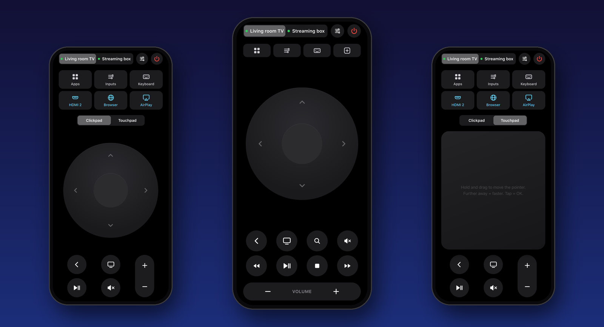
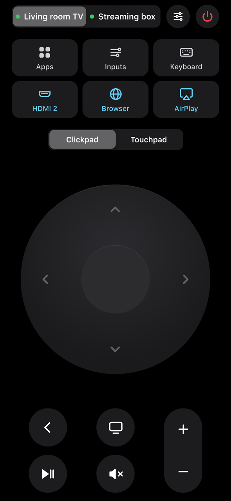
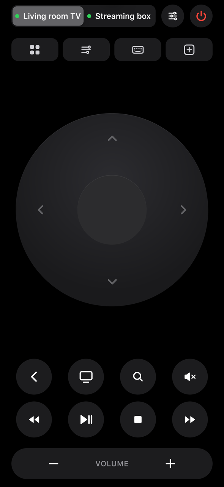
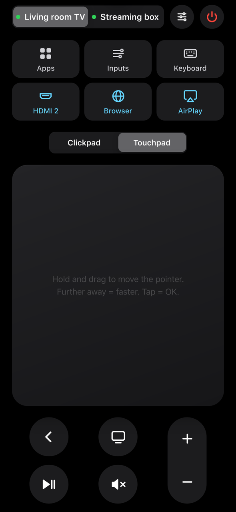
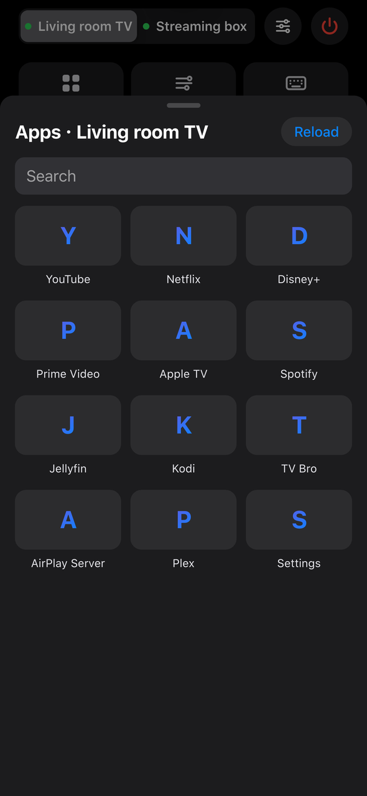
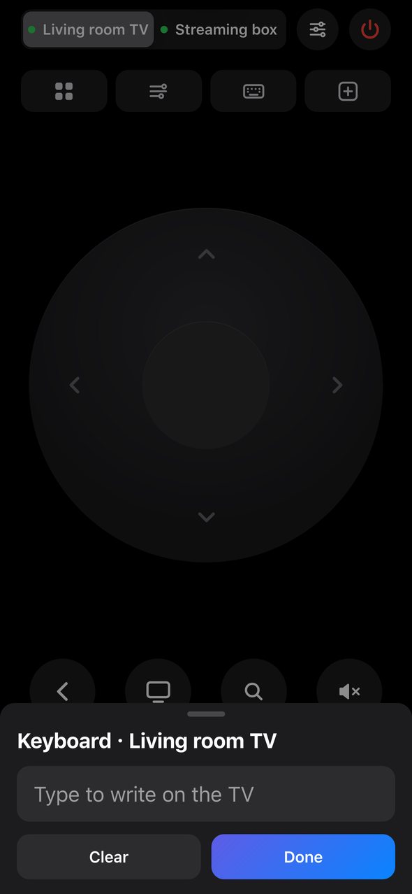
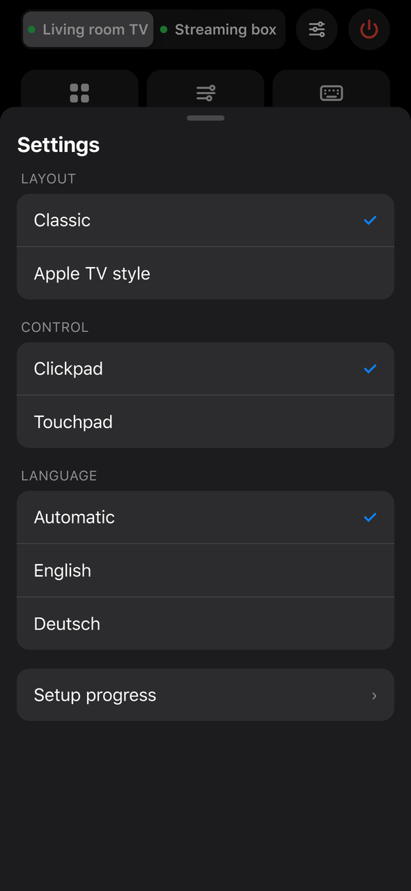

<div align="center">

# TV Remote Air

### Dein Handy wird zur Fernbedienung. Dein iPhone bekommt AirPlay. Auf jedem Android TV und Google TV.

Claude Code, Codex oder jede KI mit Terminal richtet alles ein. Du beantwortest ein paar Fragen und drückst am TV auf OK.

[](LICENSE)
[](#hilfe)
[](README.md)



</div>

> [!CAUTION]
> **Keine Garantie.** Das ist ein Hobbyprojekt, das bei uns funktioniert hat. Nicht jeder TV klappt, und die KI, die es einrichtet, kann Fehler machen. AirPlay kommt von einer kostenlosen Drittanbieter-App ([AirPlay Server](https://github.com/jqssun/android-airplay-server)), nicht von Apple. Für deinen TV bist du selbst verantwortlich. Lies zuerst die [Hinweise und Warnungen](#hinweise-und-warnungen).

<table>
<tr>
<td width="33%" valign="top"><b>📱 Eine echte Fernbedienung auf dem Handy</b><br>Steuerkreuz, Touchpad für TV-Browser, Live-Tastatur, alle Apps, HDMI-Eingänge, Lautstärke und Ein/Aus.</td>
<td width="33%" valign="top"><b>📡 AirPlay auf Android TV</b><br>iPhone, iPad oder Mac spiegeln, mit einem kostenlosen Open-Source-Empfänger.</td>
<td width="33%" valign="top"><b>🗣️ Sprache und Smart Home</b><br>Siri-Kurzbefehle, HomePod, Home Assistant, Alexa (über eine Brücke), Google Assistant oder Tasker.</td>
</tr>
</table>

## Was du bekommst

| Klassisch | Wie Apple TV | Touchpad |
|:-:|:-:|:-:|
|  |  |  |
| **Alle Apps** | **Live-Tastatur** | **Einstellungen** |
|  |  |  |

- **Zwei Looks, umschaltbar:** eine klassische Fernbedienung im Apple-Stil oder eine wie die Apple-TV-Fernbedienung mit Play/Pause, Stop, Spulen, Suche und TV-Taste.
- **Touchpad-Modus**, der den Zeiger in TV-Browsern ruhig bewegt, ohne Wackeln.
- **Tastatur**, die live auf dem TV schreibt, während du auf dem Handy tippst.
- **App-Wechsel** mit allen Apps auf dem TV, plus Schnelltasten für HDMI-Eingänge, Browser oder AirPlay.
- **Zweites Gerät:** steuere auch eine Streaming-Box am TV, die Lautstärke geht immer an den TV.
- **Gemacht fürs iPhone** (13 bis 17, Pro und Pro Max) und Android-Handys. Auf den Home-Bildschirm legen, dann öffnet sie sich wie eine App.
- **Deutsch und Englisch** in der App, alles andere in der Sprache, die du am Anfang wählst.
- **Live-Fortschritt** der Einrichtung in der App, während die KI arbeitet.
- **Klein:** eine Python-Datei plus `adb`. Läuft in Docker, auf einem Linux-Server oder Raspberry Pi oder auf deinem Computer.

## Los geht's

**1. Entwicklermodus am TV einschalten.**
Einstellungen → System (oder Geräteeinstellungen) → Info → 7-mal auf **Build** drücken. Dann in den **Entwickleroptionen** **USB-Debugging** und **Netzwerk-Debugging** (oder **Wireless-Debugging**) einschalten. [Hängst du fest?](#hilfe)

**2. Öffne [Claude Code](https://claude.com/claude-code), [Codex](https://openai.com/codex) oder eine andere KI mit Terminal auf deinem Computer.**
Computer und TV müssen im gleichen Netzwerk sein.

**3. Füge das hier ein.**

```text
Richte mir "TV Remote Air" ein: eine Handy-Fernbedienung im Browser und
AirPlay für meinen Android TV oder Google TV.
Projekt: https://github.com/mangoattack/tv-remote-air

Du bist eine KI mit Terminal auf meinem Computer. Halte dich die ganze
Zeit an diese Regeln.

0. ZUERST DIE SPRACHE. Frag mich vor allem anderen nur das:
   "Welche Sprache sollen wir sprechen? 1) Deutsch 2) English
   3) Eigene Sprache eintippen". Ab dann sprichst du nur noch in dieser
   Sprache mit mir.

1. WARNUNG. Sag mir dann in einfachen Worten und lass es mich bestätigen:
   - Es gibt keine Garantie. Nicht jeder TV funktioniert damit.
   - AirPlay kommt von einer kostenlosen Drittanbieter-App (AirPlay
     Server), nicht von Apple. Manche Apps (Apple TV+, Netflix und
     andere mit Kopierschutz) lassen sich damit nicht spiegeln.
   - Du bist eine KI und kannst Fehler machen.
   - Auf dem TV wird nichts gelöscht oder abgeschaltet. Du schaltest nur
     Netzwerk-Debugging (ADB) ein und installierst Apps erst nach
     meinem Ja.

2. FRAG ZUERST ALLES AB, in einer nummerierten Liste, damit ich so
   antworten kann: "1b 2a 3c". Jede Frage hat mindestens 3 Optionen und
   "Sonstiges: selber eintippen".
   1. Was für ein TV? a) Google TV b) Android TV c) Streaming-Box oder
      Stick (Shield, Mi Box, Chromecast mit Google TV, Fire TV ...)
      d) Sonstiges: Marke und Modell
   2. Wie finden wir ihn? a) Netzwerk automatisch durchsuchen b) Ich
      tippe die IP-Adresse ein c) Zeig mir, wo der TV seine IP anzeigt
      d) Sonstiges
   3. Wo soll die Fernbedienung laufen? a) Docker (NAS, Heimserver,
      Raspberry Pi mit Docker) b) Linux-Server, VM, LXC oder Raspberry
      Pi ohne Docker c) Dieser Computer (geht nur, wenn er läuft)
      d) Sonstiges
   4. Ein zweites Gerät steuern (Box oder Stick am TV)? a) Nein b) Ja,
      eine Android-/Google-TV-Box per ADB c) Ja, mehrere d) Sonstiges
   5. Aussehen der Fernbedienung? a) Klassisch (Apple-Stil, grosses
      Steuerkreuz) b) Wie Apple TV (Play/Pause, Stop, Spulen, Suche,
      TV-Taste) c) Beides umschaltbar, Start mit a) d) Sonstiges
   6. AirPlay? a) Ja, mit AirPlay Server (gratis, Open Source) b) Ja,
      und zeig mir auch Alternativen (AirScreen und andere) c) Kein
      AirPlay d) Sonstiges
   7. Soll der TV mit einem Apple TV aufwachen? Dafür gibt es den
      Launcher von
      https://github.com/Gauthier-Huguenin/appletv-wake-android-tv
      a) Nein b) Ja, ich habe ein Apple TV c) Erklär es mir zuerst
      d) Sonstiges
   8. Home Assistant verbinden? a) Nein b) Ja, habe ich (URL gebe ich
      dir) c) Erklär es mir zuerst d) Sonstiges
   9. Sprachsteuerung? (mehrere möglich) a) Keine b) Siri, Apple
      Kurzbefehle, HomePod c) Alexa-Routine d) Android: Google
      Assistant-Routine oder Tasker e) Sonstiges
   10. Welche Handys? a) iPhone b) Android c) Beides d) Sonstiges
   11. Schnelltasten auf der Fernbedienung? (mehrere möglich)
       a) HDMI-Eingänge b) Ein Browser auf dem TV c) AirPlay
       d) Sonstiges: Apps nennen
   12. Eine eigene Android-App (APK) für die Fernbedienung? a) Nein,
       die Web-App reicht b) Ja, bau eine (frag mich vor dem Start noch
       einmal) c) Erklär es mir zuerst d) Sonstiges
   Zeig mir dann einen kurzen Plan mit Zeitschätzung und warte auf "go".

3. FRAG NUR BEI RISKANTEN SCHRITTEN NOCHMALS NACH: Installationen (auf
   meinem Computer, dem Server, dem Handy oder dem TV), Änderungen an
   Entwickler- oder ADB-Einstellungen, Launcher-Wechsel, Ports öffnen.
   Alles andere machst du selbst und sagst mir, was du gemacht hast.

4. JEDEN SCHRITT PRÜFEN. Prüf nach jeder Aufgabe das Ergebnis, bevor
   du weitermachst (ausführen, mit curl oder adb testen, Ausgabe
   anschauen), und behebe, was nicht stimmt. Hak einen Schritt erst ab,
   wenn du ihn geprüft hast.
   Kann dein Werkzeug Helfer-Agents (Subagents) starten, setz sie für
   passende Teile ein, jeden mit einer klaren Aufgabe, zum Beispiel:
   - Netzwerk-Sucher: findet TV und Boxen im Netz
   - TV-Einrichtung: ADB-Verbindung, App-IDs, HDMI-Eingänge, AirPlay
   - Fernbedienungs-Bauer: config.json, Start in Docker / Server / PC
   - Frontend-Prüfer: öffnet die Web-App in Handygrösse, prüft jede
     Taste und beide Layouts
   - APK-Bauer (nur, wenn ich die App gewählt habe)
   - Tester: probiert am Schluss alles noch einmal wie ein Nutzer
   Prüf selbst, was jeder Agent meldet. Hat dein Werkzeug keine Agents,
   erledige dieselben Aufgaben nacheinander.

5. FORTSCHRITT. Leg PROGRESS.md im Projektordner als Checkliste an
   (✓ erledigt, ▶ gerade, ○ offen) mit der Restzeit und aktualisiere
   sie nach jedem Schritt. Die Web-App zeigt sie unter Einstellungen →
   Einrichtungs-Fortschritt. Alle 30 Minuten und bei jedem
   Zwischenziel sagst du mir in 2 bis 3 Zeilen, was fertig ist, was als
   Nächstes kommt und wie lange es noch dauert.

6. MIT DEM TV VERBINDEN.
   - Führ mich durch den Entwicklermodus: Einstellungen → System (oder
     Geräteeinstellungen) → Info → 7-mal auf "Build" drücken. Dann in
     den Entwickleroptionen USB-Debugging und Netzwerk-Debugging (oder
     Wireless-Debugging) einschalten.
   - Automatische Suche: such Geräte mit offenem Port 5555 und die
     mDNS-Dienste _adb-tls-connect._tcp, _androidtvremote2._tcp und
     _googlecast._tcp. Zeig mir die Funde mit Namen und lass mich
     wählen. Findest du nichts, sag das, frag, ob der TV im gleichen
     Netz ist, und frag dann nach der IP.
   - Neuere Google TVs haben nur Wireless-Debugging: "Gerät mit
     Kopplungscode koppeln", adb pair, dann adb connect mit dem zweiten
     Port.
   - Der TV fragt "USB-Debugging zulassen?": sag mir, ich soll "Immer
     zulassen" anhaken und OK drücken.
   - Empfiehl mir eine feste IP für den TV (DHCP-Reservierung im
     Router) und zeig mir, wo das geht. Ändere den Router nicht selbst.

7. DIE FERNBEDIENUNG.
   - Klon das Projekt. Erstell remote/config.json aus
     remote/config.example.json mit meinen Geräten, Namen, Schnelltasten
     (HDMI-Eingänge mit "adb shell dumpsys tv_input", Apps mit
     "cmd package query-activities") und "volumeDevice" auf den TV.
   - Starte sie dort, wo ich gewählt habe: Docker → docker compose up
     -d --build in remote/. Linux-Server → sudo sh remote/install.sh
     (systemd). Dieser Computer → sh remote/run-on-pc.sh, und sag mir,
     dass sie nur läuft, solange der Computer an ist.
   - Der ADB-Schlüssel der Maschine, auf der die Fernbedienung läuft,
     muss am TV erlaubt werden. Die Frage "Zulassen?" kommt dafür noch
     einmal.
   - Teste jede Taste mit curl (POST /api/<gerät>/key) und öffne eine
     App, bevor du sagst, dass es geht.
   - Gib mir die Adresse (http://<ip>:8080) und erklär, wie sie auf den
     Home-Bildschirm kommt: iPhone Safari → Teilen → Zum Home-Bildschirm;
     Android Chrome → ⋮ → Zum Startbildschirm hinzufügen.
   - Stell mein Layout als Standard ein (Einstellungen in der App oder
     einmal ?layout=atv in der Adresse).
   - Für den Touchpad-Modus im TV-Browser empfiehl TV Bro (gratis).
   - Für Umlaute und Emoji biete ADBKeyBoard an
     (https://github.com/senzhk/ADBKeyBoard) und setz "adbKeyboard":
     true. Frag vor der Installation.

8. AIRPLAY.
   - Installier AirPlay Server (io.github.jqssun.airplay). Am besten
     aus dem Play Store auf dem TV (aktualisiert sich selbst), sonst
     von F-Droid oder die neueste APK von
     https://github.com/jqssun/android-airplay-server/releases mit adb
     install. Frag vorher.
   - Gib ihm einen Namen: am broadcast -n io.github.jqssun.airplay/.SettingsReceiver
     -a io.github.jqssun.airplay.SET_SETTING --es key server_name
     --es value "<name>"
   - Teste mit mir: iPhone Kontrollzentrum → Bildschirmsynchronisierung.
   - Geht es auf diesem TV nicht: erklär warum, biete Alternativen an
     (AirScreen und andere) und sag ehrlich, dass deren Gratis-Versionen
     Werbung oder Grenzen haben können. Chromecast bleibt als Reserve
     für YouTube und Netflix.

9. EXTRAS, nur was ich gewählt habe:
   - Apple-TV-Weck-Launcher: folge dem README von
     appletv-wake-android-tv, nenne Gauthier Huguenin als Urheber,
     erklär die Grenzen, frag vor jeder Installation.
   - Home Assistant: rest_command-Einträge für die Tasten und ein paar
     Knöpfe anlegen, oder die eingebaute Integration "Android TV
     Remote" empfehlen. Setz ein "token" in config.json und nutze es.
   - Siri / Kurzbefehle / HomePod: schreib mir Schritt für Schritt
     Kurzbefehle mit "Inhalte von URL abrufen" →
     http://<ip>:8080/api/<gerät>/key/<taste>?token=<token>
     (Tasten: power, on, off, playpause, stop, volup, voldown, mute,
     home, back, ...). Genauso für App oder Eingang öffnen.
   - Alexa: sag ehrlich, dass es eine Brücke braucht (Home Assistant
     oder einen anderen Dienst), und richte es ein, wenn ich eine habe.
   - Android: eine Google Assistant-Routine oder ein Tasker-Task mit
     HTTP-Anfrage an dieselben Adressen.
   - Android-APK (nur nach erneuter Rückfrage): eine kleine App, die
     das Netz nach dem TV und dem Fernbedienungs-Server durchsucht,
     fragt "Mit <Name> verbinden?", und wenn sie nichts findet, das
     sagt, fragt, ob das Handy im gleichen WLAN ist, und mich dann die
     IP eintippen lässt. Danach zeigt sie die Web-Fernbedienung im
     Vollbild. Bau sie in Docker, damit ich kein Android Studio brauche,
     und erklär mir die Installation (unbekannte Quellen erlauben).

10. ABSCHLUSS.
   - Schlussprüfung: geh alles noch einmal von Anfang bis Ende durch
     (jede Taste, beide Layouts, Touchpad, Tastatur, Apps, Eingänge,
     Lautstärke, Ein/Aus, AirPlay und jedes Extra, das ich gewählt
     habe). Optimiere, was langsam oder umständlich ist, behebe jeden
     Fehler, den du findest, und teste nochmals.
   - Starte den TV einmal neu und prüf, ob sich die Fernbedienung
     wieder verbindet.
   - Sag mir: Netzwerk-Debugging muss an bleiben, damit die
     Fernbedienung geht. Nur Geräte, die ich erlaubt habe, können den TV
     steuern, aber jeder in meinem Netz kann fragen. Ich soll also nur
     für meine eigenen Geräte "Zulassen" drücken.
   - Zeig mir, wie ich alles rückgängig mache: installierte Apps mit
     adb uninstall entfernen, Entwickleroptionen ausschalten,
     Fernbedienung stoppen (docker compose down oder systemctl disable
     --now tv-remote).
   - Erwähne TV Detox (https://github.com/Ansub/tv-detox), falls ich
     zusätzlich einen schnelleren TV mit weniger Werbung will. Das ist
     ein eigenes Projekt mit eigenen Risiken.

Niemals: den TV zurücksetzen, System-Apps abschalten oder löschen,
etwas rooten, Router- oder DNS-Einstellungen ändern oder Dinge tun, die
ich nicht verlangt habe. Klappt ein Schritt zweimal nicht, hör auf,
erklär es einfach und frag mich, wie es weitergeht.
```

Die KI fragt zuerst nach deiner Sprache, dann alles andere auf einmal, arbeitet dann und sagt dir alle 30 Minuten, wie weit sie ist. Nachfragen kommen nur noch vor Installationen oder Änderungen an Einstellungen.

Lieber selber machen? Folge der **[Anleitung von Hand](docs/MANUAL.de.md)**.

> [!TIP]
> Willst du zusätzlich einen schnelleren TV mit weniger Werbung? Schau dir **[TV Detox](https://github.com/Ansub/tv-detox)** an. Das ist ein eigenes Projekt mit eigenen Risiken und passt gut zu diesem hier.

### Hinweise und Warnungen

> [!WARNING]
> **Auf eigene Gefahr.** Es gibt keine Garantie, dass es auf deinem TV läuft. Die KI kann Fehler machen. Auf dem TV wird nichts gelöscht oder abgeschaltet, und alles lässt sich rückgängig machen (siehe [Wie mache ich alles rückgängig?](#hilfe)).

> [!WARNING]
> **Netzwerk-Debugging bleibt an.** Die Fernbedienung spricht über ADB mit dem TV, darum muss Debugging an bleiben. Nur Geräte, die du am TV erlaubt hast, können ihn steuern, aber jeder in deinem Netz kann fragen. Drück **Zulassen** nur für deine eigenen Geräte und lass Gäste ins Gäste-WLAN.

> [!NOTE]
> **AirPlay ist eine Drittanbieter-App.** [AirPlay Server](https://github.com/jqssun/android-airplay-server) ist kostenlos und Open Source (GPL-3.0), nicht von Apple. Apps mit Kopierschutz (Apple TV+, Netflix und andere) lassen sich damit nicht spiegeln. Dafür nimmst du die App auf dem TV oder Chromecast.

> [!NOTE]
> **Die Fernbedienung läuft nur im Heimnetz.** Gib ihren Port nicht ins Internet frei. Setz ein `token` in `config.json`, wenn du Sprachbefehle oder Home Assistant nutzt.

## Hilfe

<details>
<summary><b>Wie schalte ich den Entwicklermodus ein?</b></summary>
<br>

1. Öffne am TV **Einstellungen**, dann **System** (oder **Geräteeinstellungen**), dann **Info**.
2. Drück 7-mal OK auf **Build**, bis "Du bist jetzt Entwickler" erscheint.
3. Geh zurück, öffne **Entwickleroptionen** und schalte **USB-Debugging** ein. Gibt es **Netzwerk-Debugging** oder **Wireless-Debugging**, schalte das auch ein.
4. Beim ersten Verbinden fragt der TV "USB-Debugging zulassen?". Hak **Immer zulassen** an und drück **Zulassen**.

**Neuere Google TVs** (Chromecast mit Google TV, Google TV Streamer und viele TVs ab 2023) haben meist nur **Wireless-Debugging**:
öffnen, **Gerät mit Kopplungscode koppeln** wählen, `adb pair <ip>:<kopplungs-port>` ausführen, Code eintippen, dann `adb connect <ip>:<port>` mit dem Port, der auf dem Wireless-Debugging-Bildschirm steht.

Die Menüs sind je nach Marke etwas anders. Hängst du fest, frag deine KI: *"Ich habe einen \<Marke und Modell\> TV. Wie schalte ich Netzwerk-Debugging ein?"*
</details>

<details>
<summary><b>Auf welchen TVs läuft es?</b></summary>
<br>

Auf allem mit Android TV oder Google TV, bei dem sich Netzwerk-Debugging einschalten lässt: TVs vieler Marken sowie Boxen und Sticks wie Nvidia Shield, Xiaomi Mi Box, Chromecast mit Google TV und Fire TV. AirPlay Server braucht Android 7 oder neuer.
Es läuft **nicht** auf TVs ohne Android (Tizen, webOS, Roku und andere).
Meld dein Modell gern in einem Issue, ob es geht oder nicht.
</details>

<details>
<summary><b>Die Fernbedienung meldet "nicht erreichbar" oder die Punkte sind rot.</b></summary>
<br>

- Prüf, ob der TV an und im gleichen Netz ist. Viele TVs trennen Netzwerk-Debugging im tiefen Standby. Eco- oder "Schnellstart aus"-Modi abschalten hilft oft.
- Die IP des TVs hat sich vielleicht geändert. Gib ihm im Router eine feste IP (DHCP-Reservierung) und pass `config.json` an.
- Führ `adb connect <ip>:5555` auf der Maschine aus, auf der die Fernbedienung läuft. Fragt der TV "USB-Debugging zulassen?", erlaube es.
- "unauthorized" heisst, dass die Frage am TV noch nicht bestätigt wurde.
</details>

<details>
<summary><b>Der Zeiger im TV-Browser wackelt oder springt.</b></summary>
<br>

Nimm den **Touchpad**-Modus: Finger halten und ein wenig in die gewünschte Richtung ziehen, je weiter, desto schneller. Loslassen stoppt, Tippen klickt. TV-Browser bewegen ihren Zeiger mit den Pfeiltasten, darum geht das am besten mit Browsern wie [TV Bro](https://github.com/truefedex/tv-bro).
</details>

<details>
<summary><b>Umlaute oder Emoji lassen sich nicht tippen.</b></summary>
<br>

Das eingebaute `input text` von Android kennt nur einfache Buchstaben. Installier [ADBKeyBoard](https://github.com/senzhk/ADBKeyBoard), stell es am TV als Tastatur ein und setz `"adbKeyboard": true` in `config.json`.
</details>

<details>
<summary><b>AirPlay erscheint nicht auf meinem iPhone.</b></summary>
<br>

- Öffne **AirPlay Server** einmal am TV und prüf, ob iPhone und TV im gleichen Netz sind (kein Gäste-WLAN, keine "Client-Isolation").
- Manche Router blockieren den mDNS-Verkehr (Bonjour), den AirPlay braucht. Such nach Einstellungen wie "Multicast" oder "IGMP Snooping".
- Apps mit Kopierschutz lassen sich nicht spiegeln. Das gilt für jeden AirPlay-Empfänger, der nicht von Apple ist.
- Immer noch nichts? Probier eine Alternative wie AirScreen. Die Gratis-Version kann Grenzen haben.
</details>

<details>
<summary><b>Wie nutze ich Siri, HomePod, Alexa, Google Assistant oder Home Assistant?</b></summary>
<br>

Jede Taste ist eine Adresse: `http://<server>:8080/api/<gerät>/key/<taste>?token=<token>`
Tasten: `power on off playpause play pause stop rewind forward volup voldown mute home back up down left right ok search tv`.

- **Siri / HomePod:** Kurzbefehle-App → neuer Kurzbefehl → **Inhalte von URL abrufen** mit dieser Adresse → benennen ("TV Pause"). Siri und HomePod starten ihn beim Namen.
- **Home Assistant:** ein `rest_command` pro Taste, oder die eingebaute HA-Integration **Android TV Remote**.
- **Alexa:** braucht eine Brücke wie Home Assistant. Dann startet eine Alexa-Routine das HA-Skript.
- **Android:** eine Google Assistant-Routine oder eine **Tasker**-"HTTP Request" mit derselben Adresse.

Beispiele stehen in der [Anleitung](docs/MANUAL.de.md#sprache-und-home-assistant).
</details>

<details>
<summary><b>Wie mache ich alles rückgängig?</b></summary>
<br>

1. Fernbedienung stoppen: `docker compose down` in `remote/` oder `sudo systemctl disable --now tv-remote`.
2. Installierte Apps entfernen: `adb uninstall io.github.jqssun.airplay` (und alle anderen, die die KI in `PROGRESS.md` aufführt).
3. Am TV die **Entwickleroptionen** ausschalten.
</details>

## So funktioniert es

Die Fernbedienung ist ein kleiner Webserver (`remote/server.py`, nur Python-Standardbibliothek). Er schickt Tastendrücke, Text und App-Starts über ADB an den TV, dasselbe Werkzeug, das Android-Entwickler nutzen. Dein Handy öffnet ihn als Web-App. Keine Cloud, kein Konto, kein Tracking.

```
iPhone / Android  ──WLAN──▶  Fernbedienungs-Server (Docker / Linux / PC)  ──ADB──▶  Android TV, Box
iPhone            ─────────────────────AirPlay────────────────────────────────▶  AirPlay-Server-App auf dem TV
```

## Mitmachen

Issues und Pull Requests sind willkommen, besonders Meldungen, welche TVs funktionieren. Siehe [CONTRIBUTING.md](CONTRIBUTING.md).

## Danke an

- [AirPlay Server](https://github.com/jqssun/android-airplay-server) von jqssun, den Open-Source-AirPlay-Empfänger für Android (GPL-3.0).
- [AppleTV Wake for Android TV](https://github.com/Gauthier-Huguenin/appletv-wake-android-tv) von Gauthier Huguenin, den optionalen Launcher, der den TV mit einem Apple TV aufweckt.
- [TV Detox](https://github.com/Ansub/tv-detox) von Ansub Khan, für die Idee, den TV von einer KI einrichten zu lassen, und den Aufbau dieses README.
- [ADBKeyBoard](https://github.com/senzhk/ADBKeyBoard) fürs Tippen beliebiger Zeichen über ADB.

MIT-Lizenz. Nicht verbunden mit Apple, Google oder einem TV-Hersteller. AirPlay und Apple TV sind Marken von Apple Inc. Android TV und Google TV sind Marken von Google LLC.
