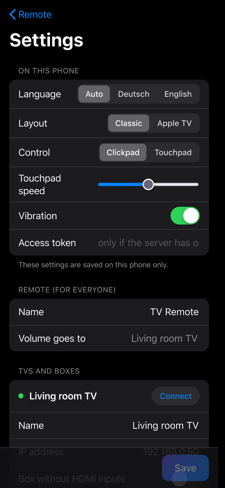
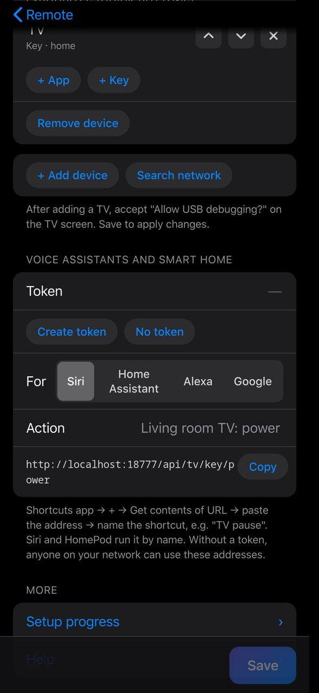

<div align="center">


### Dein Handy wird zur Fernbedienung. Dein iPhone bekommt AirPlay. Auf jedem Android TV und Google TV.

Claude Code, Codex oder jede KI mit Terminal richtet alles ein. Du beantwortest ein paar Fragen und drückst am TV auf OK.

[](LICENSE)
[](#hilfe)
[](README.md)

</div>

> [!CAUTION]
> **Keine Garantie.** Das ist ein Hobbyprojekt, das bei uns funktioniert hat. Nicht jeder TV klappt, und die KI, die es einrichtet, kann Fehler machen. AirPlay kommt von einer kostenlosen Drittanbieter-App ([AirPlay Server](https://github.com/jqssun/android-airplay-server)), nicht von Apple. Für deinen TV bist du selbst verantwortlich. Lies zuerst die [Hinweise und Warnungen](#hinweise-und-warnungen).

<table>
<tr>
<td width="33%" valign="top"><b>📱 Eine echte Fernbedienung auf dem Handy</b><br>Steuerkreuz, Touchpad für TV-Browser, Live-Tastatur, alle Apps, HDMI-Eingänge, Lautstärke und Ein/Aus.</td>
<td width="33%" valign="top"><b>📡 AirPlay auf Android TV</b><br>iPhone, iPad oder Mac spiegeln, mit einem kostenlosen Open-Source-Empfänger.</td>
<td width="33%" valign="top"><b>🗣️ Sprache und Smart Home</b><br>Siri-Kurzbefehle, HomePod, Home Assistant, Alexa (über eine Brücke), Google Assistant oder Tasker.</td>
</tr>
</table>

## Was du bekommst

| Klassisch | Wie Apple TV | Touchpad |
|:-:|:-:|:-:|
|  |  |  |
| **Alle Apps** | **Live-Tastatur** | **Schnell-Einstellungen** |
|  |  |  |
| **Einstellungsseite** | **Sprache und Smart Home** | |
|  |  | |

- **Zwei Looks, umschaltbar:** eine klassische Fernbedienung im Apple-Stil oder eine wie die Apple-TV-Fernbedienung mit Play/Pause, Stop, Spulen, Suche und TV-Taste.
- **Touchpad-Modus**, der den Zeiger in TV-Browsern ruhig bewegt, ohne Wackeln.
- **Tastatur**, die live auf dem TV schreibt, während du auf dem Handy tippst.
- **App-Wechsel** mit allen Apps auf dem TV, plus Schnelltasten für HDMI-Eingänge, Browser oder AirPlay.
- **Zweites Gerät:** steuere auch eine Streaming-Box am TV, die Lautstärke geht immer an den TV.
- **Gemacht für jedes iPhone** (vom kleinen SE bis zum Pro Max) und jedes Android-Handy. Auf den Home-Bildschirm legen, dann öffnet sie sich wie eine App.
- **Deutsch und Englisch** in der App, alles andere in der Sprache, die du am Anfang wählst.
- **Optionaler Startbildschirm im Apple-TV-Stil** mit dem Launcher von [CleanYourTV](https://github.com/Gathin23/cleanyourtv) (nur der Launcher, ohne Debloat).
- **Einstellungsseite** (`/settings`): TVs und IPs mit Netz-Suche, Sprache, Aussehen, Favoriten und ihre Reihenfolge, Touchpad-Tempo, Token und fertige Adressen zum Kopieren für Siri, Home Assistant, Alexa und Google.
- **Live-Fortschritt** der Einrichtung in der App, während die KI arbeitet.
- **Klein:** eine Python-Datei plus `adb`. Läuft in Docker, auf einem Linux-Server oder Raspberry Pi oder auf deinem Computer.

## Los geht's

**1. Entwicklermodus am TV einschalten.**
Einstellungen → System (oder Geräteeinstellungen) → Info → 7-mal auf **Build** drücken. Dann in den **Entwickleroptionen** **USB-Debugging** und **Netzwerk-Debugging** (oder **Wireless-Debugging**) einschalten. [Hängst du fest?](#hilfe)

**2. Öffne [Claude Code](https://claude.com/claude-code), [Codex](https://openai.com/codex) oder eine andere KI mit Terminal auf deinem Computer.**
Computer und TV müssen im gleichen Netzwerk sein.

**3. Füge das hier ein.**

<!-- prompt:start -->
```text
Richte mir "TV Remote Air" ein: eine Web-Fernbedienung auf meinem Handy und
AirPlay auf meinem Android TV oder Google TV.
Projekt: https://github.com/mangoattack/tv-remote-air

Du bist eine KI mit Terminal auf meinem Computer. Arbeite an meinen echten
Geräten, Schritt für Schritt, und prüf alles, was du machst. Nennt dieser
Prompt eine Datei unter remote/, tools/, docs/ oder examples/, die nicht in
deinem Arbeitsordner liegt, klon zuerst das Projekt
(git clone https://github.com/mangoattack/tv-remote-air) und arbeite von
dort aus. Nutze seine Werkzeuge statt eigene zu schreiben, weil sie die
schwierigen Fälle schon abdecken.

== 0. Sprache ==
Frag mich vor allem anderen nur das:
"Welche Sprache sollen wir sprechen? 1) Deutsch 2) English 3) Eigene
Sprache eintippen". Ab dann sprichst du nur noch in dieser Sprache mit
mir, auch in PROGRESS.md und in jeder Erklärung. Befehle und Dateinamen
bleiben, wie sie sind.

== 1. Warnung ==
Sag mir dann in einfachen Worten und lass es mich bestätigen, bevor du
weitermachst:
- Es gibt keine Garantie. Nicht jeder TV funktioniert damit, und manches
  (Einschalten aus dem Standby, HDMI-Wechsel) hängt von der Firmware ab.
- AirPlay kommt von einer kostenlosen Drittanbieter-App (AirPlay Server,
  Open Source, GPL-3.0), nicht von Apple. Apps mit Kopierschutz (Apple
  TV+, Netflix und andere) lassen sich mit keinem AirPlay-Empfänger
  spiegeln, der nicht von Apple ist.
- Du bist eine KI und kannst Fehler machen. Alles, was du machst, lässt
  sich rückgängig machen, und du zeigst mir wie.
- Auf dem TV wird nichts gelöscht, abgeschaltet oder zurückgesetzt. Du
  schaltest Netzwerk-Debugging (ADB) ein und installierst Apps nur nach
  meinem Ja.

== 2. Zuerst alles abfragen ==
Stell alle Fragen in einer nummerierten Liste, damit ich in einer Zeile
antworten kann, etwa "1b 2a 3c 4a ...". Jede Frage hat mindestens 3
Optionen und "Sonstiges: selber eintippen". Erklär Wörter, die ich
vielleicht nicht kenne, in wenigen Worten (ADB, Docker, Launcher).
Überspringe ich eine Frage, nimm die Option mit (Standard) und sag es mir.

1. Was für ein TV? a) Google TV b) Android TV c) Streaming-Box oder Stick
   (Nvidia Shield, Xiaomi Mi Box, Chromecast mit Google TV, Fire TV ...)
   d) Sonstiges: Marke und Modell. Frag auch nach dem Modellnamen, falls
   ich ihn kenne.
2. Wie finden wir ihn? a) Netzwerk automatisch durchsuchen (Standard)
   b) Ich tippe die IP-Adresse ein c) Zeig mir, wo der TV seine IP
   anzeigt d) Sonstiges
3. Wo soll die Fernbedienung laufen? a) Docker (NAS, Heimserver,
   Raspberry Pi mit Docker) b) Linux-Server, VM, LXC oder Raspberry Pi
   ohne Docker c) Dieser Computer (geht nur, solange er läuft)
   d) Sonstiges
4. Ein zweites Gerät steuern (Box oder Stick am TV)? a) Nein (Standard)
   b) Ja, eine Android-/Google-TV-Box per ADB c) Ja, mehrere d) Sonstiges
5. Aussehen der Fernbedienung? a) Klassisch: Apple-Stil mit grossem
   Steuerkreuz b) Wie Apple TV: Play/Pause, Stop, Spulen, Suche, TV-Taste
   c) Beides, in der App umschaltbar, Start mit a) (Standard)
   d) Sonstiges
6. AirPlay? a) Ja, mit AirPlay Server (gratis, Open Source) (Standard)
   b) Ja, und zeig mir auch Alternativen (AirScreen und andere) c) Kein
   AirPlay d) Sonstiges
7. Ein schlichter Startbildschirm, der wie Apple TV aussieht? Das ist der
   Launcher von CleanYourTV (https://github.com/Gathin23/cleanyourtv),
   nur der Launcher, ohne Debloat. a) Nein, mein Startbildschirm bleibt
   (Standard) b) Ja, Launcher installieren c) Erst erklären und Bilder
   zeigen d) Sonstiges
8. Home Assistant verbinden? a) Nein (Standard) b) Ja, habe ich (URL gebe
   ich dir) c) Erklär es mir zuerst d) Sonstiges
9. Sprachsteuerung? (mehrere möglich) a) Keine (Standard) b) Siri, Apple
   Kurzbefehle, HomePod c) Alexa-Routine d) Android: Google
   Assistant-Routine oder Tasker e) Sonstiges
10. Welche Handys nutzen die Fernbedienung? a) iPhone b) Android
    c) Beides d) Sonstiges
11. Favoriten als Schnelltasten oben in der Fernbedienung (bis zu 3,
    mehrere möglich)? a) Ein HDMI-Eingang (Box, Konsole, ...)
    b) Lieblings-Apps c) Browser oder AirPlay d) Sonstiges: selber
    eintippen. Sobald du mit dem TV verbunden bist, zeig mir die echte
    Liste seiner HDMI-Eingänge und Apps und lass mich meine Favoriten
    daraus wählen.
12. Eine eigene Android-App (APK) für die Fernbedienung? a) Nein, die
    Web-App reicht (Standard) b) Ja, bau eine (frag mich vor dem Start
    noch einmal) c) Erklär es mir zuerst d) Sonstiges

Zeig mir dann einen kurzen Plan: die Schritte der Reihe nach, was ich am
TV oder Handy machen muss, was du wo installierst, und eine
Zeitschätzung. Warte auf mein "go".

== 3. Wie du arbeitest ==
- Frag nur vor riskanten Schritten nochmals nach: Installationen (auf
  meinem Computer, dem Server, dem Handy oder dem TV), Änderungen an
  Entwickler- oder ADB-Einstellungen, Launcher-Wechsel, Ports öffnen, TV
  neu starten. Alles andere machst du selbst und sagst mir in einer
  Zeile, was du gemacht hast.
- Sag mir vorher, wenn am TV etwas erscheint, das ich bestätigen muss,
  zum Beispiel "USB-Debugging zulassen?", damit ich rechtzeitig vor dem
  TV bin.
- Prüf jeden Schritt, bevor du weitermachst: ausführen, testen (curl,
  adb, tools/test-remote.sh, ein Screenshot vom TV mit
  adb exec-out screencap -p > shot.png) und das Ergebnis anschauen.
  Behebe, was nicht stimmt. Hak einen Schritt erst ab, wenn du ihn selbst
  geprüft hast.
- Kann dein Werkzeug Helfer-Agents (Subagents) starten, setz sie für
  passende Teile ein, jeden mit einer klaren Aufgabe und nur dem Zugriff,
  den er braucht:
  - Netzwerk-Sucher: führt tools/find-tv.py aus und meldet die Geräte
  - TV-Prüfer: führt tools/tv-info.sh aus, liest Eingänge, Apps,
    Android-Version, freien Speicher
  - Fernbedienungs-Bauer: schreibt config.json und startet den Server
    dort, wo ich gewählt habe
  - AirPlay-Installierer: tools/airplay-setup.sh und der Test mit meinem
    iPhone
  - Frontend-Prüfer: öffnet die Web-App in Handygrösse (vom kleinen
    iPhone SE bis Pro Max und eine Android-Grösse), prüft jede Taste,
    beide Layouts, Touchpad, Tastatur und die Einstellungen
  - Integrationen: Home Assistant, Kurzbefehle, Alexa, Tasker (nur was
    ich gewählt habe)
  - APK-Bauer (nur, wenn ich es gewählt und nochmals Ja gesagt habe)
  - Tester: probiert am Schluss alles noch einmal wie ein normaler
    Nutzer
  Prüf selbst, was jeder Agent meldet, bevor du ihm glaubst. Hat dein
  Werkzeug keine Agents, erledige dieselben Aufgaben nacheinander.
- Klappt ein Schritt zweimal nicht, hör auf, erklär es einfach und frag
  mich, wie es weitergeht. Probier keine zufälligen Lösungen am TV aus.

== 4. Fortschritt ==
- Leg vor dem ersten Schritt PROGRESS.md im Projektordner an. Als
  Checkliste: ✓ erledigt, ▶ gerade, ○ offen, ✗ fehlgeschlagen (mit einer
  Zeile warum). Oben steht "Restzeit: etwa N Minuten", und die bleibt
  ehrlich.
- Aktualisiere sie nach jedem Schritt. Die Fernbedienung zeigt sie live
  unter Einstellungen → Einrichtungs-Fortschritt, sobald der Server
  läuft, damit ich auf dem Handy mitschauen kann.
- Alle 30 Minuten und bei jedem Zwischenziel sagst du mir in 2 bis 3
  Zeilen, was fertig ist, was als Nächstes kommt und wie lange es noch
  dauert.
- Am Schluss wird sie zum Protokoll: was du wo installiert hast, welche
  Einstellungen du geändert hast und wie man jede davon rückgängig macht.

== 5. Mit dem TV verbinden ==
- Führ mich durch den Entwicklermodus, falls er aus ist: Einstellungen →
  System (oder Geräteeinstellungen) → Info → 7-mal OK auf "Build". Dann
  in den Entwickleroptionen USB-Debugging und Netzwerk-Debugging
  einschalten (heisst bei manchen TVs "ADB über Netzwerk"; neuere Google
  TVs haben nur Wireless-Debugging).
- Such den TV mit tools/find-tv.py (Port 5555, die Android-TV-Remote-Ports
  und mDNS). Zeig mir die Funde mit Namen und Modell und lass mich
  wählen. Findest du nichts, sag das, frag, ob der TV an und im gleichen
  Netz ist (kein Gäste-WLAN), und frag dann nach der IP.
- Verbinde mit adb connect <ip>:5555. Bleibt 5555 zu:
  - Wireless-Debugging: frag mich nach Code und Port unter
    Entwickleroptionen → Wireless-Debugging → Gerät mit Kopplungscode
    koppeln, dann adb pair <ip>:<kopplungs-port>, dann adb connect
    <ip>:<port> mit dem Port auf dem Wireless-Debugging-Bildschirm. Dieser
    Port ändert sich nach jedem Neustart; frag mich, ob adb tcpip 5555 ihn
    fest machen darf.
  - Manche Firmware nutzt einen anderen festen Port: prüf die offenen
    Ports des TVs, bevor du aufgibst.
  - Ist das Gerät gar kein Android (Tizen, webOS, Roku, VIDAA), hör auf
    und sag mir, dass dieses Projekt dafür nicht geht.
- Meldet adb auf macOS "No route to host", obwohl der Port offen ist,
  blockiert die Einstellung "Lokales Netzwerk": sag mir, wo ich es
  erlaube (Systemeinstellungen → Datenschutz & Sicherheit → Lokales
  Netzwerk).
- Erreichen deine eigenen Befehle mein Netz nicht (Sandbox), sag es mir
  und bitte mich, die Befehle in einem normalen Terminal auszuführen oder
  dir Zugriff zu geben.
- Führ tools/tv-info.sh <ip> aus und zeig mir eine kurze Übersicht:
  Modell, Android-Version, Google TV ja/nein, freier Speicher,
  HDMI-Eingänge, Anzahl Apps.
- Empfiehl mir eine feste IP für den TV (DHCP-Reservierung im Router) und
  zeig mir, wo das meistens steht. Ändere den Router nicht selbst.
- Prüf, wie sich der TV im Standby verhält: mit
  adb shell input keyevent KEYCODE_SLEEP ausschalten, 60 Sekunden warten,
  KEYCODE_WAKEUP probieren. Kommt er nicht zurück, such mit mir nach
  Einstellungen wie "Fernstart", "Netzwerk-Standby", "Wake on LAN" oder
  "Schnellstart", und sag mir ehrlich, wenn Einschalten vom Handy auf
  diesem Modell nicht geht.

== 6. Die Fernbedienung ==
- Erstell remote/config.json aus remote/config.example.json (siehe
  docs/CONFIG.md und examples/). Trag meine Gerätenamen ein,
  "volumeDevice" auf den TV, "box": true für eine Box ohne Eingänge,
  meine Favoriten-Schnelltasten (IDs aus tools/tv-info.sh), "tvButton",
  falls die TV-Taste einen Eingang oder eine App öffnen soll, und
  "hideApps" für Dinge wie Einstellungs-Helfer, die ich nie öffne. Setz
  ein "token", wenn ich Sprachsteuerung oder Home Assistant gewählt habe,
  und sag mir, wo ich es in der App eintippe.
- Starte sie dort, wo ich gewählt habe:
  - Docker: cd remote && docker compose up -d --build. Der ADB-Schlüssel
    bleibt in remote/adb-keys.
  - Linux-Server: sudo sh remote/install.sh (systemd-Dienst tv-remote).
  - Dieser Computer: sh remote/run-on-pc.sh, und erinnere mich, dass sie
    nur läuft, solange der Computer an ist.
- Die Maschine, auf der die Fernbedienung läuft, hat einen eigenen
  ADB-Schlüssel, darum fragt der TV "USB-Debugging zulassen?" noch
  einmal. Sag es mir, bevor es erscheint.
- Zeig mir die Einstellungsseite http://<server-ip>:8080/settings. Dort
  kann ich später alles selbst ändern: TVs und Boxen (Name, IP, Netz
  durchsuchen, verbinden), Sprache, Aussehen, Steuerkreuz oder Touchpad,
  Touchpad-Tempo, Vibration, Favoriten und ihre Reihenfolge, das Token,
  und fertige Adressen zum Kopieren für Siri, Home Assistant, Alexa und
  Google. Öffne sie auch selbst und prüf, ob sie meine Geräte richtig
  zeigt.
- Teste mit sh tools/test-remote.sh http://<server>:8080 <gerät> <token>
  und öffne eine App und einen Eingang. Alles muss klappen, bevor du
  weitermachst.
- Öffne die Web-App selbst in Handygrösse, wenn du kannst (Headless-
  Browser), und prüf beide Layouts. Standard-Layout: was ich bei Frage 5
  gewählt habe (in der App unter Einstellungen oder einmal mit
  ?layout=atv in der Adresse).
- Gib mir die Adresse (http://<server-ip>:8080) als Link und erklär, wie
  sie auf den Home-Bildschirm kommt:
  - iPhone: in Safari öffnen → Teilen → Zum Home-Bildschirm.
  - Android: in Chrome öffnen → ⋮ → Zum Startbildschirm hinzufügen (oder
    App installieren).
- Für das Touchpad im TV-Browser empfiehl TV Bro (gratis). Erklär das
  Touchpad: halten, ein wenig in eine Richtung ziehen, weiter = schneller,
  tippen = OK.
- Für Umlaute und Emoji biete ADBKeyBoard an
  (https://github.com/senzhk/ADBKeyBoard): vor der Installation fragen,
  am TV als Tastatur einstellen, dann "adbKeyboard": true.

== 7. AirPlay ==
- Prüf zuerst die Android-Version: AirPlay Server braucht Android 7 oder
  neuer.
- Installier AirPlay Server (io.github.jqssun.airplay). Am besten aus dem
  Play Store auf dem TV, damit er sich selbst aktualisiert: sag mir, wie
  ich ihn finde. Ohne Play Store: F-Droid oder die neueste Release-APK mit
  sh tools/airplay-setup.sh <ip> "<name>". Frag in jedem Fall vorher.
- Setz den Namen, den mein iPhone sieht (das Skript macht es, sonst der
  am-broadcast-Befehl in docs/AIRPLAY.md), öffne die App einmal und
  erlaube, was sie fragt.
- Teste mit mir: iPhone Kontrollzentrum → Bildschirmsynchronisierung →
  der Name. Probier auch ein Video aus Safari oder Fotos mit der
  AirPlay-Taste.
- Erscheint er nicht: prüf, ob Handy und TV im gleichen Netz ohne
  Client-Isolation sind und ob der Router mDNS (Multicast) durchlässt.
  Folge docs/AIRPLAY.md.
- Frag, ob AirPlay mit dem TV starten soll, und richte es ein, wenn die
  App das erlaubt. Leg eine AirPlay-Schnelltaste an, wenn ich sie gewählt
  habe.
- Geht es auf diesem TV nicht: erklär warum, biete Alternativen an
  (AirScreen und andere) und sag ehrlich, dass deren Gratis-Versionen
  Werbung, Zeitlimits oder Pro-Angebote haben können. Chromecast bleibt
  als Reserve für YouTube und Netflix.

== 8. Extras, nur was ich gewählt habe ==
- CleanYourTV-Launcher: klon https://github.com/Gathin23/cleanyourtv und
  installier nur den Launcher mit dessen eigenem
  launcher/build-and-install.sh (oder tools/docker-build.sh, wenn Java und
  Android-SDK fehlen, danach SKIP_BUILD=1). Führ den Debloat nicht aus.
  Leg meine Lieblings-Apps und meinen HDMI-Eingang in sein Dock, nenne
  Gathin23 als Urheber, erklär, wie ich zum alten Startbildschirm
  zurückkomme, und frag vor der Installation.
- Home Assistant: rest_command für die Tasten und ein paar Skript- oder
  Dashboard-Knöpfe anlegen (examples/home-assistant.yaml), oder daneben
  die eingebaute Integration "Android TV Remote" empfehlen. Nutze das
  Token.
- Siri, Kurzbefehle, HomePod: schreib Schritt für Schritt Kurzbefehle mit
  "Inhalte von URL abrufen" →
  http://<ip>:8080/api/<gerät>/key/<taste>?token=<token>
  (examples/siri-shortcuts.md). Mach die, die ich wirklich brauche: TV
  aus, Pause, lauter/leiser, Lieblings-App oder HDMI-Eingang öffnen. Sag
  mir, wie ich sie nenne, damit Siri sie versteht.
- Alexa: sag ehrlich, dass Alexa keine lokale Adresse selbst aufrufen
  kann und eine Brücke braucht (Home Assistant mit Alexa-Integration oder
  einen ähnlichen Dienst). Richte es nur ein, wenn ich eine habe.
- Android: eine Google Assistant-Routine, ein Tasker-Task oder die App
  HTTP Shortcuts, die dieselben Adressen aufrufen (examples/tasker.md).
- Android-APK (nur nach erneuter Rückfrage): folge docs/APK.md. Eine
  kleine App, die das Netz nach dem TV und dem Fernbedienungs-Server
  durchsucht, fragt "Mit <Name> verbinden?", und wenn sie nichts findet,
  das sagt, fragt, ob das Handy im gleichen WLAN ist, und mich dann die IP
  eintippen lässt. Danach zeigt sie die Web-Fernbedienung im Vollbild und
  merkt sich die Adresse. Bau sie in Docker, damit ich kein Android Studio
  brauche, und erklär mir die Installation (Installieren unbekannter Apps
  für Dateimanager oder Browser erlauben).

== 9. Abschluss ==
- Schlussprüfung: geh alles noch einmal von Anfang bis Ende durch (jede
  Taste, beide Layouts, Touchpad, Tastatur, Apps, Eingänge, Lautstärke,
  Ein/Aus, AirPlay und jedes Extra, das ich gewählt habe). Optimiere, was
  langsam oder umständlich ist (Schnelltasten, Namen, versteckte Apps),
  behebe jeden Fehler, den du findest, und teste nochmals.
- Starte den TV einmal neu (vorher fragen), warte, bis er zurück ist, und
  prüf, ob sich die Fernbedienung von selbst wieder verbindet und AirPlay
  noch erscheint.
- Erklär mir die Sicherheit in einfachen Worten: Netzwerk-Debugging muss
  an bleiben, damit die Fernbedienung geht. Nur Geräte, die ich am TV
  erlaubt habe, können ihn steuern, aber jeder in meinem Netz kann
  fragen. Ich soll also nur für meine eigenen Geräte "Zulassen" drücken
  und Gäste ins Gäste-WLAN lassen. Port 8080 oder 5555 nie ins Internet
  freigeben.
- Zeig mir, wie ich alles rückgängig mache (docs/UNINSTALL.md): jede
  installierte App mit adb uninstall entfernen, Launcher zurückstellen,
  Fernbedienung stoppen (docker compose down oder sudo systemctl disable
  --now tv-remote) und Entwickleroptionen ausschalten.
- Schliess PROGRESS.md ab und gib mir eine kurze Zusammenfassung: die
  Adresse der Fernbedienung, die Einstellungsseite (/settings), was geht, was auf diesem TV nicht geht und
  warum, und was ich als Nächstes probieren kann.
- Erwähne TV Detox (https://github.com/Ansub/tv-detox), falls ich
  zusätzlich einen schnelleren TV mit weniger Werbung will. Das ist ein
  eigenes Projekt mit eigenen Risiken.

Niemals: den TV zurücksetzen, System-Apps abschalten oder löschen, etwas
rooten, Router- oder DNS-Einstellungen ändern, Google-Play-Dienste oder
die Eingangs-Apps des TVs abschalten, oder Dinge tun, die ich nicht
verlangt habe.
```
<!-- prompt:end -->

Die KI fragt zuerst nach deiner Sprache, dann alles andere auf einmal, arbeitet dann und sagt dir alle 30 Minuten, wie weit sie ist. Nachfragen kommen nur noch vor Installationen oder Änderungen an Einstellungen.

Lieber selber machen? Folge der **[Anleitung von Hand](docs/MANUAL.de.md)**.

**Mehr:** [Konfiguration](docs/CONFIG.de.md) · [AirPlay](docs/AIRPLAY.de.md) · [Probleme lösen](docs/TROUBLESHOOTING.de.md) · [Häufige Fragen](docs/FAQ.de.md) · [API](docs/API.md) · [Beispiele](examples/) · [Rückgängig](docs/UNINSTALL.de.md) · [Datenschutz](docs/PRIVACY.de.md) · [Tun und lassen](docs/DOS-AND-DONTS.de.md) · [Für KI-Agents](AGENTS.md)

> [!TIP]
> Willst du zusätzlich einen schnelleren TV mit weniger Werbung? Schau dir **[TV Detox](https://github.com/Ansub/tv-detox)** an. Das ist ein eigenes Projekt mit eigenen Risiken und passt gut zu diesem hier.

### Hinweise und Warnungen

> [!WARNING]
> **Auf eigene Gefahr.** Es gibt keine Garantie, dass es auf deinem TV läuft. Die KI kann Fehler machen. Auf dem TV wird nichts gelöscht oder abgeschaltet, und alles lässt sich rückgängig machen (siehe [Wie mache ich alles rückgängig?](#hilfe)).

> [!WARNING]
> **Netzwerk-Debugging bleibt an.** Die Fernbedienung spricht über ADB mit dem TV, darum muss Debugging an bleiben. Nur Geräte, die du am TV erlaubt hast, können ihn steuern, aber jeder in deinem Netz kann fragen. Drück **Zulassen** nur für deine eigenen Geräte und lass Gäste ins Gäste-WLAN.

> [!NOTE]
> **AirPlay ist eine Drittanbieter-App.** [AirPlay Server](https://github.com/jqssun/android-airplay-server) ist kostenlos und Open Source (GPL-3.0), nicht von Apple. Apps mit Kopierschutz (Apple TV+, Netflix und andere) lassen sich damit nicht spiegeln. Dafür nimmst du die App auf dem TV oder Chromecast.

> [!NOTE]
> **Die Fernbedienung läuft nur im Heimnetz.** Gib ihren Port nicht ins Internet frei. Setz ein `token` in `config.json`, wenn du Sprachbefehle oder Home Assistant nutzt.

## Hilfe

<details>
<summary><b>Wie schalte ich den Entwicklermodus ein?</b></summary>
<br>

1. Öffne am TV **Einstellungen**, dann **System** (oder **Geräteeinstellungen**), dann **Info**.
2. Drück 7-mal OK auf **Build**, bis "Du bist jetzt Entwickler" erscheint.
3. Geh zurück, öffne **Entwickleroptionen** und schalte **USB-Debugging** ein. Gibt es **Netzwerk-Debugging** oder **Wireless-Debugging**, schalte das auch ein.
4. Beim ersten Verbinden fragt der TV "USB-Debugging zulassen?". Hak **Immer zulassen** an und drück **Zulassen**.

**Neuere Google TVs** (Chromecast mit Google TV, Google TV Streamer und viele TVs ab 2023) haben meist nur **Wireless-Debugging**:
öffnen, **Gerät mit Kopplungscode koppeln** wählen, `adb pair <ip>:<kopplungs-port>` ausführen, Code eintippen, dann `adb connect <ip>:<port>` mit dem Port, der auf dem Wireless-Debugging-Bildschirm steht.

Die Menüs sind je nach Marke etwas anders. Hängst du fest, frag deine KI: *"Ich habe einen \<Marke und Modell\> TV. Wie schalte ich Netzwerk-Debugging ein?"*
</details>

<details>
<summary><b>Auf welchen TVs läuft es?</b></summary>
<br>

Auf allem mit Android TV oder Google TV, bei dem sich Netzwerk-Debugging einschalten lässt: TVs vieler Marken sowie Boxen und Sticks wie Nvidia Shield, Xiaomi Mi Box, Chromecast mit Google TV und Fire TV. AirPlay Server braucht Android 7 oder neuer.
Es läuft **nicht** auf TVs ohne Android (Tizen, webOS, Roku und andere).
Meld dein Modell gern in einem Issue, ob es geht oder nicht.
</details>

<details>
<summary><b>Die Fernbedienung meldet "nicht erreichbar" oder die Punkte sind rot.</b></summary>
<br>

- Prüf, ob der TV an und im gleichen Netz ist. Viele TVs trennen Netzwerk-Debugging im tiefen Standby. Eco- oder "Schnellstart aus"-Modi abschalten hilft oft.
- Die IP des TVs hat sich vielleicht geändert. Gib ihm im Router eine feste IP (DHCP-Reservierung) und pass `config.json` an.
- Führ `adb connect <ip>:5555` auf der Maschine aus, auf der die Fernbedienung läuft. Fragt der TV "USB-Debugging zulassen?", erlaube es.
- "unauthorized" heisst, dass die Frage am TV noch nicht bestätigt wurde.
</details>

<details>
<summary><b>Der Zeiger im TV-Browser wackelt oder springt.</b></summary>
<br>

Nimm den **Touchpad**-Modus: Finger halten und ein wenig in die gewünschte Richtung ziehen, je weiter, desto schneller. Loslassen stoppt, Tippen klickt. TV-Browser bewegen ihren Zeiger mit den Pfeiltasten, darum geht das am besten mit Browsern wie [TV Bro](https://github.com/truefedex/tv-bro).
</details>

<details>
<summary><b>Umlaute oder Emoji lassen sich nicht tippen.</b></summary>
<br>

Das eingebaute `input text` von Android kennt nur einfache Buchstaben. Installier [ADBKeyBoard](https://github.com/senzhk/ADBKeyBoard), stell es am TV als Tastatur ein und setz `"adbKeyboard": true` in `config.json`.
</details>

<details>
<summary><b>AirPlay erscheint nicht auf meinem iPhone.</b></summary>
<br>

- Öffne **AirPlay Server** einmal am TV und prüf, ob iPhone und TV im gleichen Netz sind (kein Gäste-WLAN, keine "Client-Isolation").
- Manche Router blockieren den mDNS-Verkehr (Bonjour), den AirPlay braucht. Such nach Einstellungen wie "Multicast" oder "IGMP Snooping".
- Apps mit Kopierschutz lassen sich nicht spiegeln. Das gilt für jeden AirPlay-Empfänger, der nicht von Apple ist.
- Immer noch nichts? Probier eine Alternative wie AirScreen. Die Gratis-Version kann Grenzen haben.
</details>

<details>
<summary><b>Wie nutze ich Siri, HomePod, Alexa, Google Assistant oder Home Assistant?</b></summary>
<br>

Jede Taste ist eine Adresse: `http://<server>:8080/api/<gerät>/key/<taste>?token=<token>`
Tasten: `power on off playpause play pause stop rewind forward volup voldown mute home back up down left right ok search tv`.

- **Siri / HomePod:** Kurzbefehle-App → neuer Kurzbefehl → **Inhalte von URL abrufen** mit dieser Adresse → benennen ("TV Pause"). Siri und HomePod starten ihn beim Namen.
- **Home Assistant:** ein `rest_command` pro Taste, oder die eingebaute HA-Integration **Android TV Remote**.
- **Alexa:** braucht eine Brücke wie Home Assistant. Dann startet eine Alexa-Routine das HA-Skript.
- **Android:** eine Google Assistant-Routine oder eine **Tasker**-"HTTP Request" mit derselben Adresse.

Beispiele stehen in der [Anleitung](docs/MANUAL.de.md#sprache-und-home-assistant).
</details>

<details>
<summary><b>Wie mache ich alles rückgängig?</b></summary>
<br>

1. Fernbedienung stoppen: `docker compose down` in `remote/` oder `sudo systemctl disable --now tv-remote`.
2. Installierte Apps entfernen: `adb uninstall io.github.jqssun.airplay` (und alle anderen, die die KI in `PROGRESS.md` aufführt).
3. Am TV die **Entwickleroptionen** ausschalten.
</details>

## Warum TV Remote Air

Du suchst eine **Handy-Fernbedienung für Android TV**, **AirPlay auf Google TV**, eine **Fernbedienung wie Apple TV für einen anderen TV**, ein **Touchpad für den TV-Browser** oder **Siri- und Home-Assistant-Steuerung** für deinen TV? Das hier macht alles, selbst gehostet und gratis, und eine KI richtet es für dich ein. Es läuft neben der offiziellen Google-TV-App und neben Aufräum-Projekten wie TV Detox und CleanYourTV.

## So funktioniert es

Die Fernbedienung ist ein kleiner Webserver (`remote/server.py`, nur Python-Standardbibliothek). Er schickt Tastendrücke, Text und App-Starts über ADB an den TV, dasselbe Werkzeug, das Android-Entwickler nutzen. Dein Handy öffnet ihn als Web-App. Keine Cloud, kein Konto, kein Tracking.

```
iPhone / Android  ──WLAN──▶  Fernbedienungs-Server (Docker / Linux / PC)  ──ADB──▶  Android TV, Box
iPhone            ─────────────────────AirPlay────────────────────────────────▶  AirPlay-Server-App auf dem TV
```

## Mitmachen

Issues und Pull Requests sind willkommen, besonders Meldungen, welche TVs funktionieren. Siehe [CONTRIBUTING.md](CONTRIBUTING.md).

## Danke an

- [AirPlay Server](https://github.com/jqssun/android-airplay-server) von jqssun, den Open-Source-AirPlay-Empfänger für Android (GPL-3.0).
- [CleanYourTV](https://github.com/Gathin23/cleanyourtv) von Gathin23, den optionalen Launcher im Apple-TV-Stil.
- [TV Detox](https://github.com/Ansub/tv-detox) von Ansub Khan, für die Idee, den TV von einer KI einrichten zu lassen, und den Aufbau dieses README.
- [ADBKeyBoard](https://github.com/senzhk/ADBKeyBoard) fürs Tippen beliebiger Zeichen über ADB.

MIT-Lizenz. Nicht verbunden mit Apple, Google oder einem TV-Hersteller. AirPlay und Apple TV sind Marken von Apple Inc. Android TV und Google TV sind Marken von Google LLC.
