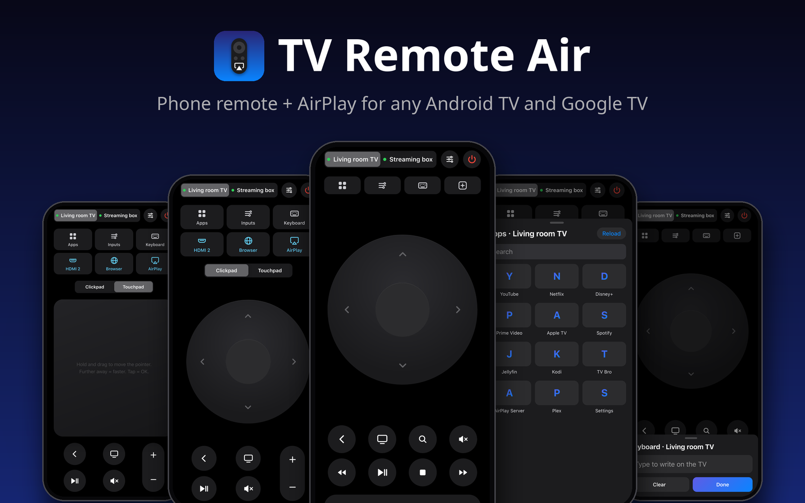
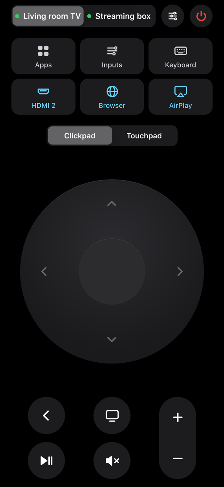
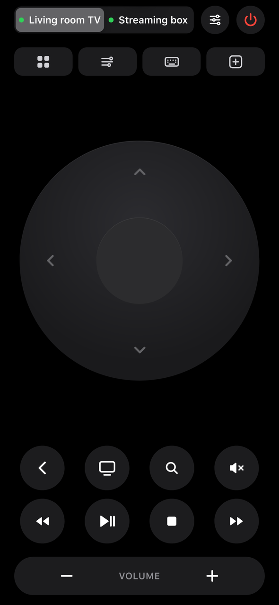
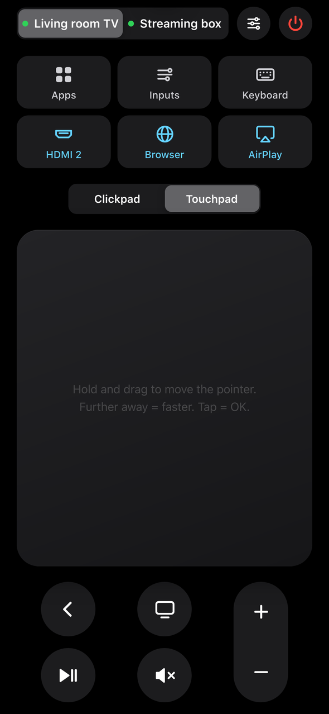
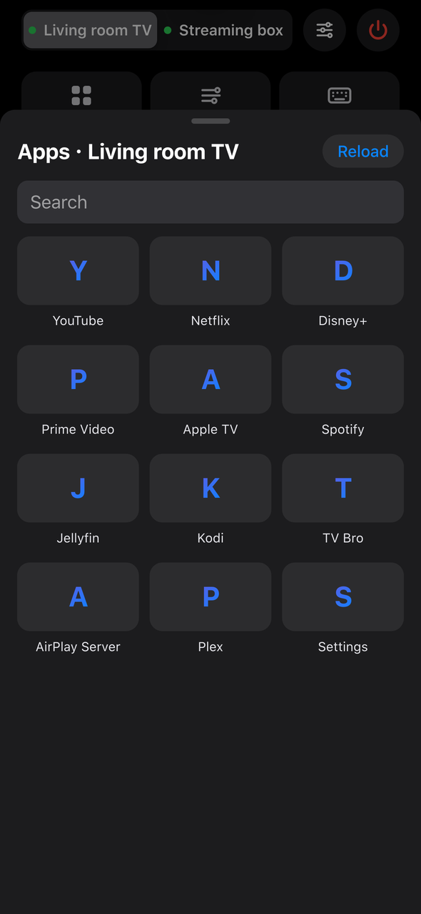
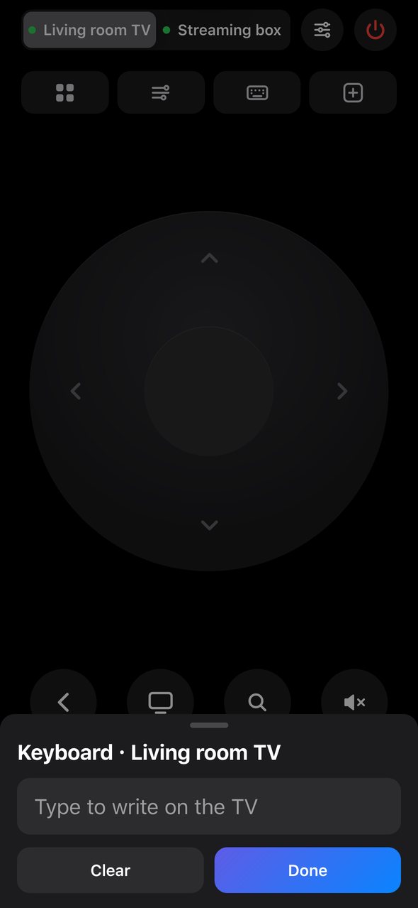
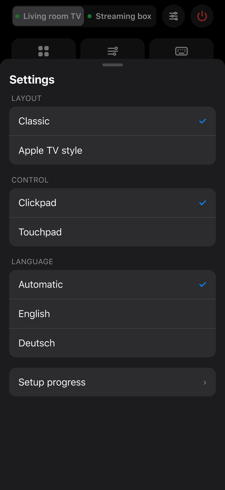

<div align="center">



### Your phone becomes the remote. Your iPhone gets AirPlay. On any Android TV or Google TV.

Claude Code, Codex or any AI with a terminal does the setup. You just answer a few questions and press OK on the TV.

[](LICENSE)
[](#help)
[](README.de.md)

</div>

> [!CAUTION]
> **No guarantee.** This is a hobby project that worked for us. Not every TV works, and the AI that sets it up can make mistakes. AirPlay comes from a free third-party app ([AirPlay Server](https://github.com/jqssun/android-airplay-server)), not from Apple. You are responsible for your own TV. Read the [notes and warnings](#notes-and-warnings) first.

<table>
<tr>
<td width="33%" valign="top"><b>📱 A real remote on your phone</b><br>Clickpad, touchpad for TV browsers, live keyboard, all apps, HDMI inputs, volume and power.</td>
<td width="33%" valign="top"><b>📡 AirPlay on Android TV</b><br>Mirror your iPhone, iPad or Mac with a free, open-source AirPlay receiver.</td>
<td width="33%" valign="top"><b>🗣️ Voice and smart home</b><br>Siri Shortcuts, HomePod, Home Assistant, Alexa (via a bridge), Google Assistant or Tasker.</td>
</tr>
</table>

## What you get

| Classic | Apple TV style | Touchpad |
|:-:|:-:|:-:|
|  |  |  |
| **All apps** | **Live keyboard** | **Settings** |
|  |  |  |

- **Two looks, switchable:** a classic Apple-style remote, or one like the Apple TV remote with play/pause, stop, rewind, fast forward, search and a TV button.
- **Touchpad mode** that moves the pointer in TV browsers smoothly, without shaking.
- **Keyboard** that types on the TV live while you type on the phone.
- **App switcher** with every app on the TV, plus quick buttons for HDMI inputs, a browser or AirPlay.
- **Second device:** control a streaming box behind the TV too; volume always goes to the TV.
- **Made for every iPhone** (from the small SE to the Pro Max) and every Android phone. Add it to the home screen and it opens like an app.
- **English and German** in the app, everything else in the language you pick at the start.
- **Optional Apple TV-style home screen** with the [CleanYourTV](https://github.com/Gathin23/cleanyourtv) launcher (launcher only, no debloat).
- **Live setup progress** in the app while the AI works.
- **Small:** one Python file plus `adb`. Runs in Docker, on a Linux server or Raspberry Pi, or on your computer.

## Get started

**1. Turn on developer mode on the TV.**
Settings → System (or Device Preferences) → About → press **Build** 7 times. Then turn on **USB debugging** and **Network debugging** (or **Wireless debugging**) in **Developer options**. [Stuck?](#help)

**2. Open [Claude Code](https://claude.com/claude-code), [Codex](https://openai.com/codex) or another AI with a terminal on your computer.**
The computer and the TV must be on the same network.

**3. Paste this in.**

<!-- prompt:start -->
```text
Set up "TV Remote Air" for me: a web remote on my phone and AirPlay on my
Android TV or Google TV. Project: https://github.com/mangoattack/tv-remote-air

You are an AI with a terminal on my computer. Work on my real devices, step
by step, and check everything you do. Where this prompt names a file under
remote/, tools/, docs/ or examples/ that isn't in your working folder,
clone the project first (git clone https://github.com/mangoattack/tv-remote-air)
and work from there. Use its tools instead of writing your own, because
they already handle the tricky cases.

== 0. Language ==
Before anything else, ask me only this:
"Which language should we use? 1) Deutsch 2) English 3) Type your own
language". From then on, talk to me only in that language, also in
PROGRESS.md and in every explanation. Keep commands and file names as
they are.

== 1. Warning ==
Then tell me in plain words, and ask me to confirm before you go on:
- There is no guarantee. Not every TV works with this, and some features
  (power on from standby, HDMI switching) depend on the TV's firmware.
- AirPlay comes from a free third-party app (AirPlay Server, open source,
  GPL-3.0), not from Apple. Copy-protected apps (Apple TV+, Netflix and
  others) can't be mirrored with any AirPlay receiver that isn't Apple's.
- You are an AI and can make mistakes. Everything you do can be undone,
  and you will show me how.
- Nothing on the TV gets deleted, disabled or reset. You turn on network
  debugging (ADB) and install apps only after I say yes.

== 2. Ask everything first ==
Ask all questions in one numbered list, so I can answer in one line like
"1b 2a 3c 4a ...". Every question has at least 3 options plus
"Other: type your own". Explain words I may not know in a few words
(ADB, Docker, launcher). If I skip a question, use the option marked
(default) and tell me.

1. What is the TV? a) Google TV b) Android TV c) Streaming box or stick
   (Nvidia Shield, Xiaomi Mi Box, Chromecast with Google TV, Fire TV ...)
   d) Other: brand and model. Ask for the model name too if I know it.
2. How do we find it? a) Search my network automatically (default)
   b) I type the IP address c) Show me where the TV shows its IP d) Other
3. Where should the remote run? a) Docker (NAS, home server, Raspberry Pi
   with Docker) b) A Linux server, VM, LXC or Raspberry Pi without Docker
   c) This computer (only works while it is on) d) Other
4. A second device to control (box or stick behind the TV)? a) No
   (default) b) Yes, one Android/Google TV box over ADB c) Yes, several
   d) Other
5. Look of the remote? a) Classic: Apple style with a big clickpad
   b) Apple TV style: play/pause, stop, rewind, fast forward, search, TV
   button c) Both, switchable in the app, start with a) (default)
   d) Other
6. AirPlay? a) Yes, with AirPlay Server (free, open source) (default)
   b) Yes, and also show me alternatives (AirScreen and others) c) No
   AirPlay d) Other
7. A clean home screen that looks like an Apple TV? This is the launcher
   from CleanYourTV (https://github.com/Gathin23/cleanyourtv), only the
   launcher, no debloat. a) No, keep my home screen (default) b) Yes,
   install the launcher c) Explain it first and show screenshots d) Other
8. Connect Home Assistant? a) No (default) b) Yes, I have it (I'll give
   you the URL) c) Explain it first d) Other
9. Voice control? (several allowed) a) None (default) b) Siri, Apple
   Shortcuts, HomePod c) Alexa routine d) Android: Google Assistant
   routine or Tasker e) Other
10. Which phones will use the remote? a) iPhone b) Android c) Both
    d) Other
11. Favourites as quick buttons at the top of the remote (up to 3,
    several allowed)? a) An HDMI input (box, console, ...) b) Favourite
    apps c) Browser or AirPlay d) Other: type them. Once you are connected
    to the TV, show me the real list of its HDMI inputs and apps and let
    me pick my favourites from it.
12. An extra Android app (APK) for the remote? a) No, the web app is
    enough (default) b) Yes, build one (ask me again before you start)
    c) Explain it first d) Other

Then show me a short plan: the steps in order, what I have to do on the
TV or the phone, what you will install and where, and a time estimate.
Wait for my "go".

== 3. How you work ==
- Only ask again before risky steps: installing anything (on my
  computer, the server, the phone or the TV), changing developer or ADB
  settings, changing the launcher, opening ports, restarting the TV.
  Do everything else yourself and tell me what you did in one line.
- Tell me before something appears on the TV that I must accept, for
  example "Allow USB debugging?", so I'm in front of the TV in time.
- Check every step before you move on: run it, test it (curl, adb,
  tools/test-remote.sh, a screenshot from the TV with
  adb exec-out screencap -p > shot.png) and look at the result. Fix what
  is wrong. Only mark a step ✓ when you checked it yourself.
- If your tool can start helper agents (subagents), use them for parts
  that fit, each with one clear job and only the access it needs:
  - Network scout: runs tools/find-tv.py and reports the devices
  - TV inspector: runs tools/tv-info.sh, reads inputs, apps, Android
    version, free storage
  - Remote builder: writes config.json and starts the server where I chose
  - AirPlay installer: tools/airplay-setup.sh and the test with my iPhone
  - Frontend checker: opens the web app at phone size (small iPhone SE
    up to Pro Max, and an Android size), checks every button, both
    layouts, touchpad, keyboard and the settings sheet
  - Integrations: Home Assistant, Shortcuts, Alexa, Tasker (only what I
    picked)
  - APK builder (only if I picked it and said yes again)
  - Tester: at the end tries everything once more like a normal user
  Check what each agent reports yourself before you trust it. If your
  tool has no agents, do the same jobs one after another.
- If a step fails twice, stop, explain it simply, and ask me how to go
  on. Don't try random fixes on the TV.

== 4. Progress ==
- Create PROGRESS.md in the project folder before the first step. Use a
  checklist: ✓ done, ▶ now, ○ open, ✗ failed (with one line why). Put
  "Time left: about N minutes" at the top and keep it honest.
- Update it after every step. The remote shows it live under
  Settings → Setup progress, so I can follow on my phone once the server
  runs.
- Every 30 minutes, and at every milestone, tell me in 2 or 3 lines:
  what is done, what comes next, how much time is left.
- At the end it becomes the record: what you installed, where, which
  settings you changed, and how to undo each one.

== 5. Connect to the TV ==
- Walk me through developer mode if it is off: Settings → System (or
  Device Preferences) → About → press OK on "Build" 7 times. Then in
  Developer options turn on USB debugging and Network debugging (some
  TVs call it "ADB over network"; newer Google TVs only have Wireless
  debugging).
- Find the TV with tools/find-tv.py (port 5555, the Android TV remote
  ports and mDNS). Show me what you found with names and models and let
  me pick. If nothing is found, say so, ask if the TV is on and on the
  same network (not a guest network), and then ask for the IP.
- Connect with adb connect <ip>:5555. If 5555 stays closed:
  - Wireless debugging: ask me for the code and port under Developer
    options → Wireless debugging → Pair device with pairing code, then
    adb pair <ip>:<pairing port>, then adb connect <ip>:<port> with the
    port shown on the Wireless debugging screen. That port changes after
    every restart; ask me if adb tcpip 5555 may make it fixed.
  - Some firmware uses another fixed port: check the TV's open ports
    before you give up.
  - If the device is not Android at all (Tizen, webOS, Roku, VIDAA),
    stop and tell me this project can't help with it.
- On macOS, if adb says "No route to host" while the port is open, the
  Local Network privacy setting blocks it: tell me where to allow it
  (System Settings → Privacy & Security → Local Network).
- If your own commands can't reach my network (a sandbox), tell me, and
  ask me to run the commands in a normal terminal or give you access.
- Run tools/tv-info.sh <ip> and show me a short summary: model, Android
  version, Google TV yes/no, free storage, HDMI inputs, number of apps.
- Recommend a fixed IP for the TV (DHCP reservation in the router) and
  show me where that setting usually is. Don't change the router
  yourself.
- Check how the TV behaves in standby: turn it off with
  adb shell input keyevent KEYCODE_SLEEP, wait 60 seconds, try
  KEYCODE_WAKEUP. If it doesn't come back, look for settings like
  "Remote start", "Network standby", "Wake on LAN" or "Quick start" with
  me, and tell me honestly if power on from the phone won't work on this
  model.

== 6. The remote ==
- Create remote/config.json from remote/config.example.json (see
  docs/CONFIG.md and examples/). Set my device names, "volumeDevice" to
  the TV, "box": true for a box without inputs, my favourite quick
  buttons (ids from tools/tv-info.sh), "tvButton" if I want the TV button
  to open an input or app, and "hideApps" for things like settings
  helpers I never open. Set a "token" if I picked voice control or Home
  Assistant, and tell me where to type it in the app.
- Start it where I chose:
  - Docker: cd remote && docker compose up -d --build. The ADB key is
    kept in remote/adb-keys.
  - Linux server: sudo sh remote/install.sh (systemd service tv-remote).
  - This computer: sh remote/run-on-pc.sh, and remind me it only works
    while the computer is on.
- The machine that runs the remote has its own ADB key, so the TV asks
  "Allow USB debugging?" once more. Tell me before it appears.
- Test with sh tools/test-remote.sh http://<server>:8080 <device> <token>
  and open one app and one input. All must pass before you go on.
- Open the web app yourself at phone size if you can (headless browser)
  and check both layouts. Default layout: what I picked in question 5
  (in the app under Settings, or once with ?layout=atv in the URL).
- Give me the address (http://<server-ip>:8080) as a link and explain how
  to put it on the home screen:
  - iPhone: open it in Safari → Share → Add to Home Screen.
  - Android: open it in Chrome → ⋮ → Add to Home screen (or Install app).
- For the touchpad in TV browsers, suggest TV Bro (free). Explain the
  touchpad: hold, drag a little in a direction, further = faster, tap =
  OK.
- For typing umlauts and emoji, offer ADBKeyBoard
  (https://github.com/senzhk/ADBKeyBoard): ask before installing it, set
  it as the TV keyboard, then "adbKeyboard": true.

== 7. AirPlay ==
- Check the Android version first: AirPlay Server needs Android 7 or
  newer.
- Install AirPlay Server (io.github.jqssun.airplay). Best from the Play
  Store on the TV, so it updates itself: tell me how to find it. Without
  Play Store: F-Droid or the latest release APK with
  sh tools/airplay-setup.sh <ip> "<name>". Ask first either way.
- Set the name my iPhone will see (the script does it, or the
  am broadcast command in docs/AIRPLAY.md), open the app once and allow
  what it asks.
- Test it with me: iPhone Control Center → Screen Mirroring → the name.
  Also try playing a video from Safari or Photos with the AirPlay button.
- If it doesn't show up: check that phone and TV are on the same network
  without client isolation, and that the router passes mDNS (multicast).
  Follow docs/AIRPLAY.md.
- Ask if AirPlay should start with the TV, and set it up if the app
  allows it. Add an AirPlay quick button if I picked it.
- If it doesn't work on this TV: explain why, then offer alternatives
  (AirScreen and others) and say honestly that their free versions can
  have ads, time limits or a Pro upsell. Chromecast stays as a backup for
  YouTube and Netflix.

== 8. Extras, only what I picked ==
- CleanYourTV launcher: clone https://github.com/Gathin23/cleanyourtv and
  install only the launcher with its own launcher/build-and-install.sh
  (or tools/docker-build.sh if Java and the Android SDK are missing, then
  SKIP_BUILD=1). Don't run its debloat. Put my favourite apps and HDMI
  input in its dock, credit Gathin23, explain how to switch back to the
  old home screen, and ask before installing.
- Home Assistant: add a rest_command for the keys and a few script or
  dashboard buttons (examples/home-assistant.yaml), or suggest the
  built-in "Android TV Remote" integration next to it. Use the token.
- Siri, Shortcuts, HomePod: write step by step Shortcuts with
  "Get contents of URL" → http://<ip>:8080/api/<device>/key/<key>?token=<token>
  (examples/siri-shortcuts.md). Make the ones I'll really use: TV off,
  pause, volume up/down, open my favourite app or HDMI input. Tell me how
  to name them so Siri understands them.
- Alexa: say honestly that Alexa can't call a local address by itself and
  needs a bridge (Home Assistant with the Alexa integration, or a similar
  service). Set it up only if I have one.
- Android: a Google Assistant routine or a Tasker task, or the HTTP
  Shortcuts app, calling the same URLs (examples/tasker.md).
- Android APK (only after asking me again): follow docs/APK.md. A small
  app that searches the network for the TV and the remote server, asks
  "Connect to <name>?", and if it finds nothing says so, asks if the
  phone is on the same Wi-Fi, then lets me type the IP. Then it shows the
  web remote full screen and remembers the address. Build it in Docker so
  I don't need Android Studio, and tell me how to install it (allow
  installing unknown apps for my file manager or browser).

== 9. Finish ==
- Final review: go through everything once more from start to end
  (every button, both layouts, touchpad, keyboard, apps, inputs, volume,
  power, AirPlay and every extra I picked). Optimise what is slow or
  clumsy (quick buttons, names, hidden apps), fix every error you find,
  and test again.
- Restart the TV once (ask first), wait until it's back, and check that
  the remote reconnects by itself and AirPlay still shows up.
- Tell me about security in plain words: network debugging must stay on
  for the remote to work. Only devices I allowed on the TV screen can
  control it, but anyone on my network can ask, so I should only press
  Allow for my own devices and keep guests on a guest network. Never
  forward port 8080 or 5555 to the internet.
- Show me how to undo everything (docs/UNINSTALL.md): adb uninstall each
  app you installed, switch back the launcher, stop the remote
  (docker compose down, or sudo systemctl disable --now tv-remote), and
  turn off developer options.
- Finish PROGRESS.md and give me a short summary: the remote's address,
  what works, what doesn't on this TV and why, and what I can try next.
- Mention TV Detox (https://github.com/Ansub/tv-detox) if I also want a
  faster TV with fewer ads. That's a separate project with its own risks.

Never: reset the TV, disable or uninstall system apps, root anything,
change router or DNS settings, disable Google Play services or the
TV's own input apps, or do things I didn't ask for.
```
<!-- prompt:end -->

The AI asks for your language first, then everything else in one go, then works and tells you every 30 minutes how far it is. It only asks again before installing something or changing a setting.

Prefer to do it yourself? Follow the **[manual setup](docs/MANUAL.md)**.

> [!TIP]
> Want a faster TV with fewer ads as well? Have a look at **[TV Detox](https://github.com/Ansub/tv-detox)**. It's a separate project with its own risks, and it works well next to this one.

### Notes and warnings

> [!WARNING]
> **Do it at your own risk.** There is no guarantee that it works on your TV. The AI can make mistakes. Nothing on the TV is deleted or turned off, and everything can be undone (see [How do I undo everything?](#how-do-i-undo-everything)).

> [!WARNING]
> **Network debugging stays on.** The remote talks to the TV over ADB, so debugging must stay on. Only devices you allowed on the TV screen can control it, but anyone on your network can ask. Only press **Allow** for your own devices, and put guests on a guest network.

> [!NOTE]
> **AirPlay is a third-party app.** [AirPlay Server](https://github.com/jqssun/android-airplay-server) is free and open source (GPL-3.0), not made by Apple. Apps with copy protection (Apple TV+, Netflix and others) can't be mirrored with it. For those, use the TV's own app or Chromecast.

> [!NOTE]
> **The remote only works in your home network.** Don't forward its port to the internet. Set a `token` in `config.json` if you use voice shortcuts or Home Assistant.

## Help

<details>
<summary><b>How do I turn on developer mode?</b></summary>
<br>

1. On the TV, open **Settings**, then **System** (or **Device Preferences**), then **About**.
2. Press OK on **Build** 7 times until you see "You are now a developer."
3. Go back, open **Developer options** and turn on **USB debugging**. If you see **Network debugging** or **Wireless debugging**, turn that on too.
4. The first time a computer connects, the TV asks "Allow USB debugging?" Tick **Always allow** and press **Allow**.

**Newer Google TVs** (Chromecast with Google TV, Google TV Streamer and many 2023+ TVs) usually only have **Wireless debugging**:
open it, choose **Pair device with pairing code**, run `adb pair <ip>:<pairing port>`, type the code, then `adb connect <ip>:<port>` with the port shown on the Wireless debugging screen.

Menus differ by brand. If you're stuck, ask your AI: *"I have a \<brand and model\> TV. How do I turn on network debugging?"*
</details>

<details>
<summary><b>Which TVs does it work on?</b></summary>
<br>

Anything that runs Android TV or Google TV and lets you turn on network debugging: TVs from many brands, and boxes or sticks like Nvidia Shield, Xiaomi Mi Box, Chromecast with Google TV and Fire TV. AirPlay Server needs Android 7 or newer.
It does **not** work on TVs without Android (Tizen, webOS, Roku and others).
Please open an issue with your model, working or not.
</details>

<details>
<summary><b>The remote says "not reachable" or the dots are red.</b></summary>
<br>

- Check the TV is on and on the same network. Many TVs drop network debugging in deep standby. Turning off "Eco" or "Quick start off" modes often helps.
- The TV's IP may have changed. Give it a fixed IP in your router (DHCP reservation) and update `config.json`.
- Run `adb connect <ip>:5555` on the machine that runs the remote. If the TV shows "Allow USB debugging?", allow it.
- "unauthorized" means the prompt on the TV was not accepted yet.
</details>

<details>
<summary><b>The pointer in the TV browser shakes or jumps.</b></summary>
<br>

Use **Touchpad** mode: hold your finger and drag a little in the direction you want, the further the faster. Lift to stop, tap to click. TV browsers move their pointer with arrow keys, so this works best with browsers like [TV Bro](https://github.com/truefedex/tv-bro).
</details>

<details>
<summary><b>Typing umlauts or emoji doesn't work.</b></summary>
<br>

Android's built-in `input text` only handles plain letters. Install [ADBKeyBoard](https://github.com/senzhk/ADBKeyBoard), set it as the keyboard on the TV and set `"adbKeyboard": true` in `config.json`.
</details>

<details>
<summary><b>AirPlay doesn't show up on my iPhone.</b></summary>
<br>

- Open **AirPlay Server** on the TV once, and check iPhone and TV are on the same network (not a guest network, no "client isolation").
- Some routers block the mDNS (Bonjour) traffic AirPlay needs. Look for "multicast" or "IGMP snooping" settings.
- Copy-protected apps can't be mirrored. That's a limit of every AirPlay receiver that isn't from Apple.
- Still nothing? Try an alternative like AirScreen. Its free version can have limits.
</details>

<details>
<summary><b>How do I use Siri, HomePod, Alexa, Google Assistant or Home Assistant?</b></summary>
<br>

Every button is a URL: `http://<server>:8080/api/<device>/key/<key>?token=<token>`
Keys: `power on off playpause play pause stop rewind forward volup voldown mute home back up down left right ok search tv`.

- **Siri / HomePod:** Shortcuts app → new shortcut → **Get contents of URL** with that address → name it ("TV pause"). Siri and HomePod run it by name.
- **Home Assistant:** a `rest_command` per key, or use HA's built-in **Android TV Remote** integration.
- **Alexa:** needs a bridge such as Home Assistant. Then an Alexa routine triggers the HA script.
- **Android:** a Google Assistant routine or a **Tasker** "HTTP Request" with the same URL.

See the [manual](docs/MANUAL.md#voice-and-home-assistant) for examples.
</details>

<details>
<summary><b>How do I undo everything?</b></summary>
<br>

1. Stop the remote: `docker compose down` in `remote/`, or `sudo systemctl disable --now tv-remote`.
2. Remove apps that were installed: `adb uninstall io.github.jqssun.airplay` (and any other the AI lists in `PROGRESS.md`).
3. On the TV, turn off **Developer options**.
</details>

## How it works

The remote is a small web server (`remote/server.py`, Python standard library only). It sends key presses, text and app starts to the TV over ADB, the same tool Android developers use. Your phone opens it as a web app. No cloud, no account, no tracking.

```
iPhone / Android  ──Wi-Fi──▶  remote server (Docker / Linux / PC)  ──ADB──▶  Android TV, box
iPhone            ─────────────────────AirPlay──────────────────────────▶  AirPlay Server app on the TV
```

## Contributing

Issues and pull requests are welcome, especially reports of which TVs work. See [CONTRIBUTING.md](CONTRIBUTING.md).

## Credits

- [AirPlay Server](https://github.com/jqssun/android-airplay-server) by jqssun, the open-source AirPlay receiver for Android (GPL-3.0).
- [CleanYourTV](https://github.com/Gathin23/cleanyourtv) by Gathin23, the optional Apple TV-style launcher.
- [TV Detox](https://github.com/Ansub/tv-detox) by Ansub Khan, for the idea of letting an AI set up the TV, and the README layout.
- [ADBKeyBoard](https://github.com/senzhk/ADBKeyBoard) for typing any character over ADB.

MIT License. Not affiliated with Apple, Google or any TV maker. AirPlay and Apple TV are trademarks of Apple Inc. Android TV and Google TV are trademarks of Google LLC.
